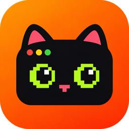
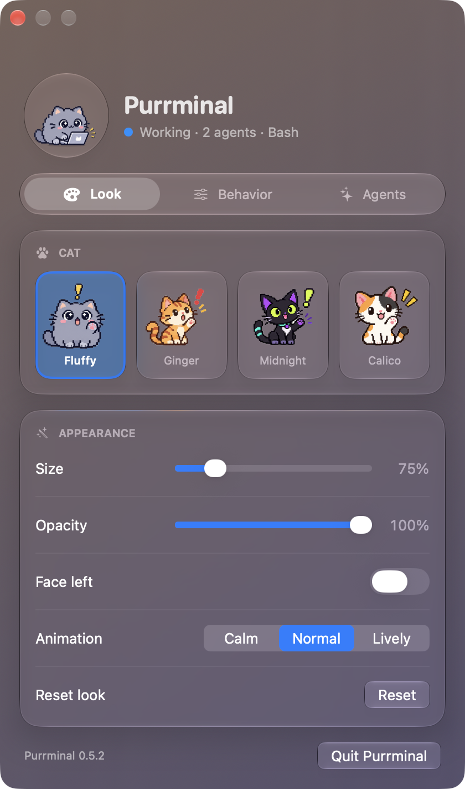

<p align="center">
  
</p>

<h1 align="center">Purrminal</h1>

<p align="center">
  <b>A pixel desktop pet for macOS that shows what Claude Code and other AI coding agents are doing.</b><br>
  It naps while the agent is idle, types while it works, waves when it needs you and cries when a tool fails.
</p>

<p align="center">
  <a href="../../releases/latest"></a>
  
  
  
  <a href="LICENSE"></a>
</p>

<p align="center">
  
</p>

Stop alt-tabbing to the terminal to see whether your agent is waiting for you. Glance at the cat.

Purrminal is a free, open-source Claude Code status indicator for the Mac desktop. It reads Claude Code hooks, so you
see agent status, permission prompts and tool errors without watching the terminal. Codex CLI, Gemini CLI, Cursor,
Aider and any script can drive it too.

## Features

- **Live Claude Code status.** Thinking, the current tool (`Bash`, `Edit`, `Read`…), done or failed.
- **Know when your agent needs you.** On a permission request or notification the cat hops and says `allow Bash?`.
- **Errors you can't miss.** A failed tool call shows the tool name in a red bubble under a rain cloud.
- **Many agents at once.** Every session and subagent gets its own status. The cat shows the one that matters most
  (waiting for you > error > working > done) and names it: `Twitter: allow Bash?`, `3 agents · Edit`.
- **Make it yours.** Four cats (Fluffy, Ginger, Midnight, Calico), size 50–200%, opacity, facing direction,
  animation speed, speech bubbles always / alerts only / off.
- **Stays out of the way.** Drag it anywhere and it remembers the spot. Hide it from the menu bar paw.
  Always on top, on every Space, launch at login: each is a switch.
- **Native and light.** Two Swift files, no Electron, no network access, no telemetry.

| State | When | Cat |
|---|---|---|
| idle | no agent activity | sleeping, zzz |
| working | prompt sent, tool running | typing on a laptop, tool name in the bubble |
| waiting | permission request or notification | hops, "allow Bash?" |
| done | agent finished its turn | jumps with confetti |
| error | a tool call failed | tears and a rain cloud |

<p align="center">
  
</p>

## Install

**Download.** Get `Purrminal.zip` from the [latest release](../../releases/latest), unzip it, move `Purrminal.app`
to Applications and open it. The app is ad-hoc signed, not notarized: on first launch right-click it and choose
**Open**.

**Connect Claude Code.** The first launch opens Settings on the **Agents** tab. Press **Install hooks** and the cat
starts following every Claude Code session. Hooks need `jq`, which ships with macOS 15 and later; on older systems run
`brew install jq` first.

**From source.** Needs the Xcode command line tools (`swiftc`) and `jq`:

```bash
git clone <repo-url> Purrminal && cd Purrminal
./install.sh
```

`install.sh` builds the app, copies it to `~/Applications` and installs the hooks.

Hooks are added to `~/.claude/settings.json` without touching your other settings, and a backup is saved as
`settings.json.purrminal-backup`. Installing again is safe.

### Uninstall

```bash
./install.sh --uninstall
```

This removes the hooks from `~/.claude/settings.json` and deletes the app from `~/Applications`.

## How it works

Claude Code [hooks](https://docs.anthropic.com/en/docs/claude-code/hooks) call `~/.purrminal/hook.sh` on
`UserPromptSubmit`, `PreToolUse`, `PostToolUse`, `PostToolUseFailure`, `PermissionRequest`, `Notification`, `Stop`,
`SubagentStop` and `SessionEnd`. The script writes one small file per session (and per subagent) to
`~/.purrminal/sessions/` with the state, a caption and the session name. The app reads them a few times per second
and picks the state by priority.

- A `Stop` while background subagents still run keeps the cat working.
- A session with no events for 5 minutes is ignored.

Nothing leaves your machine.

### Other agents

Any other tool can drive the cat through one shared file: Codex CLI, Gemini CLI, Cursor, Aider or your own script.

```bash
printf 'working\nnpm test\n' > ~/.purrminal/state   # idle | working | waiting | done | error
```

## Build from source

```bash
./build.sh                                   # Purrminal.app + dist/Purrminal.zip (VERSION=x.y.z ./build.sh)
swiftc -O main.swift settings.swift -o Purrminal && ./Purrminal   # dev binary, reads sprites/ next to it
./Purrminal --gif demo.gif                   # render the demo GIF
./Purrminal --sheet sheet.png                # render every state as a sprite sheet
./Purrminal --status                         # print what the cat shows right now
python3 slice.py drafts/cat-a.png sprites/ginger 408   # re-cut a skin from its concept sheet
                                             # fluffy=cat-c, midnight=cat-b (425), calico=cat-d (404)
python3 icon/make_icon.py icon/source.png    # rebuild icon/AppIcon.icns
```

| Path | What |
|---|---|
| `main.swift` | the cat window, state reader, animation, menus |
| `settings.swift` | preferences and the Settings window |
| `purrminal-hook.sh` | the Claude Code hook |
| `install.sh` | build, install, hooks only (`--hooks`), uninstall |
| `sprites/<skin>/` | one painted pose per state |
| `drafts/` | concept sheets the sprites are sliced from |
| `icon/` | app icon source and build script |

## Limitations

- There is one painted pose per state; motion comes from squash, hops and shakes.
- Only Claude Code is detected automatically. Other agents use the shared state file.
- The app is not notarized yet.

## FAQ

**How do I know when Claude Code needs my approval?** Install Purrminal and its hooks. When Claude Code asks for a
permission, the cat hops and shows the request, for example `allow Bash?`.

**Does it work with Codex CLI, Gemini CLI or Cursor?** Yes, through the shared state file described in
[Other agents](#other-agents). Only Claude Code is connected automatically.

**Does it send any data?** No. The app has no network code and no telemetry; all state lives in `~/.purrminal`.

**Which macOS versions are supported?** macOS 13 Ventura and later. The release build is for Apple silicon; on Intel,
build from source.

## Contributing

Issues and pull requests are welcome. Keep it native: no new dependencies, no network calls.

## License

[MIT](LICENSE)
